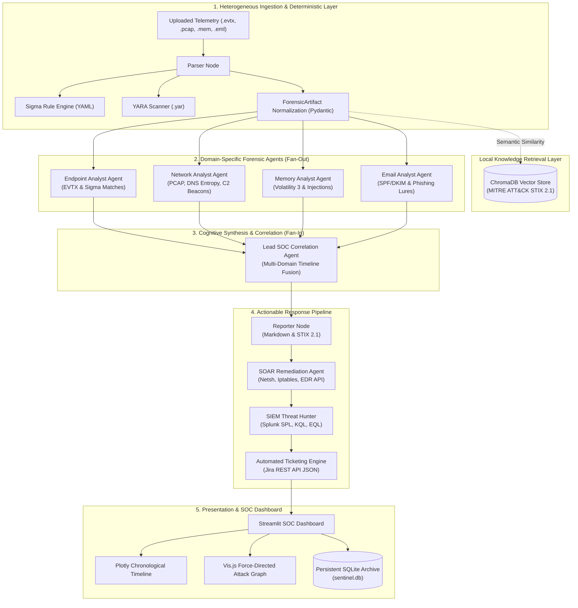

# SENTINEL Architecture & Multi-Agent Flow

SENTINEL utilizes a modular, multi-agent AI architecture built on **LangGraph**. By decomposing complex forensic investigations into specialized sub-agents with strict deterministic guardrails, SENTINEL avoids prompt context exhaustion, minimizes hallucinations, and maintains auditable causality chains across multiple forensic domains.

---

## 🏗️ High-Level State Machine (LangGraph DAG)

The core orchestration engine operates as a Directed Acyclic Graph (DAG) using a shared, strictly typed `AgentState`:



---

## 🔍 Detailed Component Breakdown

### 1. Ingestion & Normalization (`src/schema.py`)
Incoming telemetry files are parsed and normalized into standard `ForensicArtifact` Pydantic models:

```python
class ForensicArtifact(BaseModel):
    timestamp: str          # ISO 8601 normalized event timestamp
    source_type: str        # e.g., EVTX_4688, PCAP_DNS_TUNNEL, EML_URL
    host: Optional[str]     # Hostname or IP address
    user: Optional[str]     # Username or account identifier
    details: str            # Raw command line, DNS query, or header summary
    ioc_detected: Optional[str] # Extracted IP, domain, hash, or suspicious URL
```

### 2. Deterministic Guardrails (Sigma & YARA)
To ensure reliable, auditable detection of known malicious indicators:
* **Sigma Engine (`src/parsers/sigma_scanner.py`):** Ingests community YAML Sigma rules from `rules/sigma/`. Checks normalized EVTX event details for known adversarial techniques (e.g., encoded PowerShell execution, remote WMI process creation, volume shadow copy deletion).
* **YARA Engine (`src/parsers/yara_scanner.py`):** Automatically compiles `.yar` signatures from `rules/yara/` to scan memory dumps and file binaries for PsExec artifacts, lateral movement tools, and ransomware headers.

### 3. Local RAG & MITRE ATT&CK Mapping (`src/kb/`)
* **Embedding Model:** `all-MiniLM-L6-v2` dense sentence representations running locally via `sentence-transformers`.
* **Vector Store:** **ChromaDB** indexed against enterprise MITRE ATT&CK STIX 2.1 objects.
* **Operation:** When suspicious activities are identified, SENTINEL performs semantic vector similarity queries to retrieve exact MITRE Technique IDs (e.g., `T1059.001 - PowerShell`, `T1071.004 - DNS Tunneling`, `T1566.002 - Spearphishing Link`).

---

## 🤖 The Multi-Agent Pipeline

### A. Domain Specialist Agents (Fan-Out)
Rather than overloading a single model with thousands of disparate logs, four dedicated sub-agents evaluate their specific forensic domains independently:

1. **💻 Endpoint Analyst Agent:**
   * Examines Windows Security logs (Event IDs `4624`, `4625`, `4688`, `4104`, `7045`).
   * Evaluates parent-child process hierarchies and Sigma rule detections.
   * Identifies privilege escalation, execution, and persistence techniques.

2. **🌐 Network Analyst Agent:**
   * Computes **Shannon Entropy** over DNS query subdomains to flag high-entropy DNS tunneling tools (e.g., Iodine, DNSCat2).
   * Parses HTTP streams to identify unencrypted credential transmissions and exfiltration payloads.
   * Computes temporal connection counts to flag periodic Command and Control (C2) beacons.

3. **🧠 Memory Analyst Agent:**
   * Evaluates Volatility 3 outputs (`windows.pslist`, `windows.netscan`, `windows.malfind`).
   * Detects reflective DLL injection, process hollowing, and in-RAM YARA signature hits.

4. **📧 Email / Phishing Analyst Agent:**
   * Audits RFC 5322 email headers for SPF (`Received-SPF`) and DKIM authentication failures.
   * Extracts embedded hyperlink targets to uncover credential harvesting lures.
   * Flags high-urgency social engineering patterns and suspicious file attachments.

---

### B. Lead SOC Correlation Agent (Fan-In)
The **Lead SOC Analyst** acts as the synthesis hub. It takes the summarized intelligence outputs from all four domain specialists and fuses them into a **single, chronological attack story**.

By reasoning over multi-source evidence, it establishes causality:
$$\text{Phishing Lure} \xrightarrow{\text{Delivery}} \text{DNS Beacon} \xrightarrow{\text{C2 Established}} \text{Process Execution} \xrightarrow{\text{Privilege Escalation}} \text{Data Exfiltration}$$

---

### C. Closed-Loop Action Pipeline
Following correlation, SENTINEL automatically triggers proactive defensive actions:

1. **🛡️ SOAR Remediation Agent:**
   * Synthesizes host firewall commands (`netsh advfirewall` for Windows, `iptables` for Linux).
   * Formats REST API payloads for active EDR isolation (CrowdStrike Falcon, Microsoft Defender API).
   * Generates custom Sigma and YARA rules to detect future occurrences of the observed threat.

2. **🔍 SIEM Threat Hunter:**
   * Authors target hunting queries in **Splunk SPL** across index telemetry.
   * Authors **Microsoft Sentinel / Azure KQL** queries targeting `DeviceProcessEvents` and `DeviceNetworkEvents`.
   * Authors **Elastic EQL** queries to trace parent-child process chains and network connections.

3. **🎫 Automated Ticketing Engine:**
   * Transforms incident findings, timelines, and remediation recommendations into a structured, validated **Jira / ServiceNow REST API JSON payload**.

---

## 💾 Forensic Data Lifecycle & SQLite Persistence

SENTINEL uses a persistent SQLite database (`data/sentinel.db`) with a data reduction architecture:

```
[ Raw Artifacts (temp_uploads/) ]  <-- Multi-gigabyte PCAP, EVTX, RAM dumps
               │
               ▼ (Extracted & Normalized)
[ Normalized ForensicArtifacts ]   <-- Structured Pydantic objects (KB size)
               │
               ▼ (Investigated & Correlated)
[ SQLite Database (data/sentinel.db) ] <-- Permanent Case Archive
               │
               ▼ (Instant Retrieval)
[ Dashboard "Case History" Replay ] <-- Instant reconstruction of charts and reports
```

### Storage Efficiency & Instant Replay
* **99.9% Data Reduction:** Storing raw memory dumps or packet captures for every investigation is unsustainable. SENTINEL extracts high-value security evidence into serialized JSON strings in SQLite.
* **Zero Re-computation:** When an archived case is opened in the dashboard, the pre-computed timelines, agent summaries, attack relationships, and reports are deserialized in milliseconds without re-invoking the LLM.
