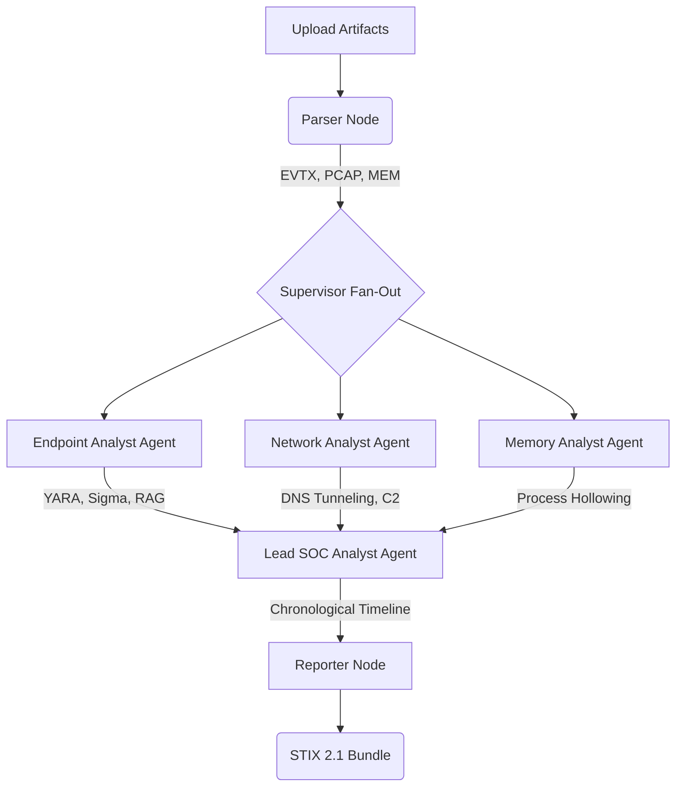

# SENTINEL Architecture

SENTINEL utilizes a modular, multi-agent AI architecture built on **LangGraph**. By breaking the forensic analysis down into specialized sub-agents, SENTINEL avoids hallucinations, reduces prompt context limits, and allows for deeper analytical reasoning.

## High-Level Pipeline

## Agent Responsibilities

### 1. 💻 Endpoint Agent
Ingests raw Windows Event Logs (EVTX). It automatically correlates events against the internal Sigma rule engine and enriches matches with MITRE ATT&CK TTPs.

### 2. 🌐 Network Agent
Analyzes PCAP traffic. Uses custom logic to flag anomalous DNS requests (calculating Shannon Entropy for DNS Tunneling) and tracks statistical temporal connections to flag C2 Beacons.

### 3. 🧠 Memory Agent
Parses output from Volatility3 memory dumps, detecting malware strings and process injection techniques in RAM.

### 4. ⚡ Lead SOC Analyst
Fuses the intelligence outputs of the specialized agents. Since each specialized agent summarizes its own domain concisely, the Lead SOC Analyst only processes the most important evidence to construct a unified chronological narrative.

## Persistent Case Memory
All cases are tracked asynchronously in a local **SQLite** database (`sentinel.db`), providing persistent case management without external dependencies.
